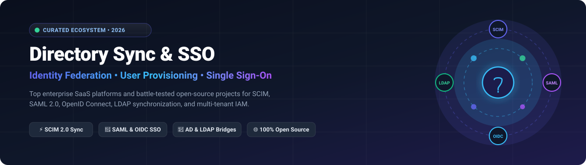

# 🔐 Awesome Directory Synchronization & SSO

<p align="center">
  
</p>

<p align="center">
  <a href="https://github.com/ishandutta2007/Awesome-Awesome-Awesome"></a>
  <a href="https://discord.gg/jc4xtF58Ve"></a>
  <a href="https://github.com/ishandutta2007/Awesome-Directory-Synchronization-SSO/stargazers"></a>
  <a href="https://github.com/ishandutta2007/Awesome-Directory-Synchronization-SSO/network/members"></a>
  <a href="https://github.com/ishandutta2007/Awesome-Directory-Synchronization-SSO/blob/main/LICENSE"></a>
  <a href="https://github.com/ishandutta2007"></a>
</p>

---

## ⚡ Top Directory Synchronization, IAM & Single Sign-On (SSO) Ecosystem

> 🎯 **A comprehensive, SEO-optimized, curated guide to enterprise SaaS platforms and self-hosted open-source software for Identity Federation, Directory Synchronization (SCIM/LDAP/Active Directory), and Single Sign-On (SAML 2.0 / OpenID Connect / OAuth 2.1).**

*📅 Last updated: March 2026*

This directory tracks battle-tested **enterprise SaaS suites** and high-performance **open-source identity infrastructure** powering modern identity synchronization and authentication workflows. Whether you are provisioning thousands of enterprise seats across hybrid Active Directory forests or automating just-in-time (JIT) SAML and SCIM sync into SaaS apps, this curated ecosystem covers everything from turn-key cloud IdPs to self-hosted zero-trust identity architectures.

---

## 📑 Table of Contents

- [📊 Sector Overview & Market Dynamics](#-sector-overview--market-dynamics)
- [☁️ SaaS & Hosted Enterprise Platforms](#️-saas--hosted-enterprise-platforms)
- [🚀 Open-Source GitHub Projects](#-open-source-github-projects)
- [🛠️ Architecture & Best Practices](#️-architecture--best-practices)
- [🤝 How to Contribute](#-how-to-contribute)
- [💖 Support & Sponsoring](#-support--sponsoring)
- [⭐ Star History](#-star-history)
- [📜 Disclaimer](#-disclaimer)

---

## 📊 Sector Overview & Market Dynamics

The global **Identity and Access Management (IAM)** and **Single Sign-On (SSO)** market is valued between **$24B and $27B in 2026** (with the dedicated enterprise SSO and federation market representing approximately **$4.5B to $5.5B**), accelerating at a CAGR of ~12%–14%. 

The sector features an **oligopolistic, heavily concentrated structure at the enterprise core**—dominated by hyperscalers and dedicated platform champions including **Microsoft Entra ID** and **Okta**. Concurrently, there is **moderate to high fragmentation across the modular identity and developer tooling layers**, where agile SaaS platforms and robust open-source engines lead the charge for multi-tenant CIAM, SCIM 2.0 provisioning bridges, passkey/FIDO2 authentication, and vendor-neutral hybrid directory synchronization.

---

## ☁️ SaaS & Hosted Enterprise Platforms

| Platform | Company Size (Valuation / Market Cap / Revenue) | Description | Pricing (Starting Tier) | Free Tier Limits / Trial |
| :--- | :--- | :--- | :--- | :--- |
| **[Microsoft Entra Connect](https://www.microsoft.com/en-us/security/business/)** | ~$3.1T Market Cap (Microsoft; >$245B Annual Revenue) | Synchronizes on-premises Active Directory with Microsoft Entra ID (Azure AD). Enables hybrid identity, password hash sync, pass-through authentication, and seamless SSO. | Free sync tool included; Entra ID P1 starts at $6.00 per user/month | Free forever plan included with Microsoft cloud services (up to 50,000 directory objects, or 300,000 with custom domain; core SSO & MFA) |
| **[Google Cloud Identity](https://cloud.google.com/identity)** | ~$2.1T Market Cap (Alphabet; >$350B Annual Revenue) | Cloud-native identity platform with directory sync from AD/LDAP, SSO, MFA, and device management. Integrates with Google Workspace and GCP. | $6 per user/month (Cloud Identity Premium edition) | Free forever plan (Cloud Identity Free includes up to 50 user licenses, SSO, MFA, and AD/LDAP directory sync) |
| **[Salesforce Identity Connect](https://help.salesforce.com/)** | ~$280B Market Cap (Salesforce; >$38B Annual Revenue) | Synchronizes users and groups from Active Directory to Salesforce. Enables SSO via SAML and automates user provisioning/deprovisioning based on AD group membership. | $1 per user/month (billed annually as Enterprise/Performance/Unlimited edition add-on) | 30-day trial (standard Salesforce trial); Developer Edition includes 10 Identity Connect licenses free forever |
| **[Rippling Identity](https://www.rippling.com/)** | $13.5B Valuation (Private; ~$350M+ ARR) | Unified identity and device management platform. Features HRIS-driven provisioning, SSO, and automated onboarding/offboarding workflows. | $8 per user/month (Unity base platform + $6 per user/month for Identity/App Management module) | 14-day free trial (available for IT Cloud & Identity Management modules upon demo verification) |
| **[Okta Universal Directory](https://www.okta.com/)** | ~$12B Market Cap (Okta; ~$2.6B Annual Revenue) | Centralized identity store supporting any number of user attributes and custom schemas. Features directory integration, profile mastering, and lifecycle management across apps. | $6 per user/month (Workforce Starter Suite; $1,500/year contract minimum) | 30-day free trial (fully functional workforce sandbox up to 100 users, no credit card required) |
| **[PingFederate](https://www.pingidentity.com/)** | $2.8B Acquisition Valuation (Thoma Bravo; ~$350M+ ARR) | Enterprise federation server supporting SAML, OAuth, OIDC, and WS-Fed. Features identity bridging, attribute mapping, and high-availability clustering. | $3 per user/month (PingOne Workforce Essential; enterprise on-prem PingFederate deployments start at ~$50,000/year) | 30-day free trial (PingOne cloud evaluation sandbox supporting up to 1,000 active identities) |
| **[JumpCloud Directory Insights](https://jumpcloud.com/)** | $2.6B Valuation (Private; ~$150M+ ARR) | Cloud-based directory platform with event logging and audit trails. Features cross-platform user management, device management, and SSO across cloud and on-prem resources. | $9 per user/month (Device Management; SSO Package starts at $11 per user/month billed annually) | 30-day free trial (full platform access with all premium features and directory sync; no credit card required) |
| **[OneLogin Desktop](https://www.onelogin.com/)** | ~$500M Acquisition Estimate (One Identity / Quest Software; ~$60M ARR) | Desktop SSO solution for Mac and Windows. Provides seamless login to cloud apps and on-prem resources with MFA enforcement. | $2 per user/month (Starter SSO package billed annually) | 30-day free trial (unlimited app connections, desktop SSO, MFA, and cloud directory integration) |
| **[miniOrange SSO](https://www.miniorange.com/)** | Bootstrapped / Private (~$18M Annual Revenue) | Affordable SSO and MFA solution for cloud and on-prem apps. Supports SAML, OAuth, JWT, and directory sync. | $1.50 per user/month (Cloud IAM Essential SSO plan) | Free forever plan for small environments (up to 500 users with basic SSO/directory sync); 30-day free trial for premium enterprise tier |
| **[DualShield](https://www.deepnetsecurity.com/)** | Privately Held / Niche (~$3M–$5M Annual Revenue) | Enterprise authentication platform with SSO, MFA, and directory integration. Supports AD, LDAP, and RADIUS with flexible policy controls. | $1.50 per user/month (estimate based on minimum 100-user enterprise license tiers via reseller channels) | 30-day free trial (available upon proof-of-concept request for on-prem/private cloud evaluation) |

---

## 🚀 Open-Source GitHub Projects

*Sorted in descending order by GitHub Stargazers. Each project includes social badge metrics linking directly to its stargazer community.*

- **[Keycloak](https://github.com/keycloak/keycloak)** [](https://github.com/keycloak/keycloak/stargazers)  
  Leading open-source identity and access management platform (Apache-2.0), hosted under the CNCF. Supports SSO, social sign-in, MFA, LDAP/Active Directory user federation, Kerberos, SAML 2.0, and OpenID Connect with dynamic high-availability clustering.

- **[Authelia](https://github.com/authelia/authelia)** [](https://github.com/authelia/authelia/stargazers)  
  The Single Sign-On Multi-Factor portal for web applications (Apache-2.0). OpenID Certified™ and post-quantum cryptography ready. Integrates seamlessly with reverse proxies (Nginx, Traefik, Caddy, Envoy) and LDAP/Active Directory backend directories.

- **[Authentik](https://github.com/goauthentik/authentik)** [](https://github.com/goauthentik/authentik/stargazers)  
  Modern, customizable open-source Identity Provider (GPL-3.0/MIT elements). Features SAML 2.0, OAuth2/OIDC, forward-auth, LDAP outpost synchronization, SCIM provisioning, and flexible flow orchestration for self-hosters and enterprises alike.

- **[Sa-Token](https://github.com/dromara/Sa-Token)** [](https://github.com/dromara/Sa-Token/stargazers)  
  High-performance, lightweight Java authentication and authorization framework (Apache-2.0). Includes built-in Single Sign-On (SSO) modes, OAuth 2.0 server capabilities, distributed session management, and microservice gateway token synchronization.

- **[Ory Hydra](https://github.com/ory/hydra)** [](https://github.com/ory/hydra/stargazers)  
  Hardened, headless OpenID Certified™ OpenID Connect and OAuth 2.1 authorization server (Apache-2.0). Connects with any identity directory or existing user management system to power secure API and SSO federation at enterprise scale.

- **[SuperTokens](https://github.com/supertokens/supertokens-core)** [](https://github.com/supertokens/supertokens-core/stargazers)  
  Modular, open-source alternative to Auth0, AWS Cognito, and Firebase Auth (Apache-2.0). Provides end-to-end Enterprise SSO (SAML/OIDC), session architecture, user role management, and multi-tenant directory authentication.

- **[ZITADEL](https://github.com/zitadel/zitadel)** [](https://github.com/zitadel/zitadel/stargazers)  
  Cloud-native identity infrastructure built for multi-tenancy and auditability (Apache-2.0). Provides turnkey SSO, Passkeys/FIDO2, OIDC, SAML, SCIM 2.0 directory provisioning, LDAP bridging, and an immutable event stream.

- **[OAuth2 Proxy](https://github.com/oauth2-proxy/oauth2-proxy)** [](https://github.com/oauth2-proxy/oauth2-proxy/stargazers)  
  Reverse proxy and SSO authentication layer (MIT) providing authentication against major IdPs (Google, Azure AD, Keycloak, GitHub, and generic OIDC/OAuth providers) for internal infrastructure and legacy web apps.

- **[Logto](https://github.com/logto-io/logto)** [](https://github.com/logto-io/logto/stargazers)  
  Modern open-source identity and access management suite (MPL-2.0). Built on OIDC and OAuth 2.1 with native multi-tenancy, enterprise SSO, automated role-based access control (RBAC), and developer-friendly administration APIs.

- **[Casdoor](https://github.com/casdoor/casdoor)** [](https://github.com/casdoor/casdoor/stargazers)  
  UI-first identity and access management platform (Apache-2.0). Supports OAuth 2.0, OIDC, SAML, CAS, LDAP synchronization, SCIM directory provisioning, WebAuthn, TOTP, and direct sync with Google Workspace and Azure AD.

- **[Ory Kratos](https://github.com/ory/kratos)** [](https://github.com/ory/kratos/stargazers)  
  Next-generation, headless cloud-native identity and user management system (Apache-2.0). Handles self-service registration, multi-factor authentication (MFA), passwordless passkeys, profile schemas, and secure session management.

- **[Apereo CAS](https://github.com/apereo/cas)** [](https://github.com/apereo/cas/stargazers)  
  Enterprise-grade multilingual Single Sign-On engine for the web (Apache-2.0). Supports CAS protocol, SAML 2.0, OAuth 2.0, OpenID Connect, WS-Federation, and deep bidirectional synchronization with LDAP, Active Directory, and relational databases.

- **[Dex](https://github.com/dexidp/dex)** [](https://github.com/dexidp/dex/stargazers)  
  OpenID Connect (OIDC) identity provider and authentication broker (Apache-2.0) with pluggable connectors. Acts as a federation portal to LDAP, SAML, GitHub, Google, and Active Directory across Kubernetes and cloud environments.

- **[Hanko](https://github.com/teamhanko/hanko)** [](https://github.com/teamhanko/hanko/stargazers)  
  Lightweight passkey-first authentication and user management engine (AGPL-3.0). Supports WebAuthn, social logins, Enterprise SAML SSO, TOTP, and embedded authentication widgets with ultra-fast latency.

- **[Kanidm](https://github.com/kanidm/kanidm)** [](https://github.com/kanidm/kanidm/stargazers)  
  Modern, fast, and secure identity management platform and directory service written in Rust (MPL-2.0). Operates as an alternative to FreeIPA and Active Directory with built-in OAuth2/OIDC, RADIUS, and SSH key management.

- **[pac4j](https://github.com/pac4j/pac4j)** [](https://github.com/pac4j/pac4j/stargazers)  
  Multi-protocol security engine for Java frameworks (Apache-2.0). Supports SAML, CAS, OpenID Connect, OAuth, LDAP, and JWT federation across Spring Boot, Play, Dropwizard, and J2EE applications.

- **[BoxyHQ Jackson](https://github.com/boxyhq/jackson)** [](https://github.com/boxyhq/jackson/stargazers)  
  Enterprise SSO & Directory Sync service (Apache-2.0). Provides turnkey SAML 2.0, OIDC, and SCIM 2.0 directory synchronization (supporting Okta, Azure AD, Google Workspace, and OneLogin) as an API service.

- **[caddy-security](https://github.com/greenpau/caddy-security)** [](https://github.com/greenpau/caddy-security/stargazers)  
  Enterprise authentication and authorization plugin for the Caddy v2 web server (Apache-2.0). Implements SAML, OIDC, OAuth 2.0, LDAP, MFA, and local directory federation natively.

- **[MaxKey](https://github.com/dromara/MaxKey)** [](https://github.com/dromara/MaxKey/stargazers)  
  Enterprise IAM / IDaaS platform (Apache-2.0). Supports OAuth 2.0, OIDC, SAML 2.0, CAS, JWT, and SCIM user lifecycle management with RBAC permission models and LDAP synchronization.

- **[privacyIDEA](https://github.com/privacyidea/privacyidea)** [](https://github.com/privacyidea/privacyidea/stargazers)  
  Modular multi-factor authentication and token management system (AGPL-3.0). Synchronizes with existing user stores (LDAP, Active Directory, SQL, flat files) and powers OTP, Push, and FIDO2/WebAuthn tokens.

- **[SSOReady](https://github.com/ssoready/ssoready)** [](https://github.com/ssoready/ssoready/stargazers)  
  Open-source developer toolsuite for shipping Enterprise SAML Single Sign-On and SCIM directory synchronization (MIT). Provides intuitive SDKs across TypeScript, Python, Go, and Java.

- **[Rauthy](https://github.com/sebadob/rauthy)** [](https://github.com/sebadob/rauthy/stargazers)  
  Fast, lightweight Single Sign-On Identity & Access Management server written in Rust (Apache-2.0). Implements OpenID Connect, OAuth 2.0, WebAuthn passkeys, and PAM/Linux synchronization with minimal resource usage.

- **[SimpleSAMLphp](https://github.com/simplesamlphp/simplesamlphp)** [](https://github.com/simplesamlphp/simplesamlphp/stargazers)  
  Battle-tested PHP-native authentication and federation suite (LGPL-2.1). Industry standard for configuring SAML 2.0 Identity Providers and Service Providers across academic, government, and enterprise directories.

- **[OpenAM](https://github.com/OpenIdentityPlatform/OpenAM)** [](https://github.com/OpenIdentityPlatform/OpenAM/stargazers)  
  Community-maintained enterprise access management solution (CDDL-1.0). Provides federated SSO (SAML 2.0, OAuth2, OpenID Connect), fine-grained authorization, and directory entitlements.

- **[Apache Syncope](https://github.com/apache/syncope)** [](https://github.com/apache/syncope/stargazers)  
  Digital identity management platform from the Apache Software Foundation (Apache-2.0). Specializes in identity provisioning, access governance, SCIM 2.0 connectivity, and bidirectional directory reconciliation across disparate stores.

- **[LSC (LDAP Synchronization Connector)](https://github.com/lsc-project/lsc)** [](https://github.com/lsc-project/lsc/stargazers)  
  Robust open-source directory synchronization tool (BSD license). Connects relational databases, Active Directory, OpenLDAP, and flat files to synchronize, transform, and normalize user and group data via Groovy/JavaScript scripting.

- **[AWS SSO SCIM Sync](https://github.com/slashdevops/idp-scim-sync)** [](https://github.com/slashdevops/idp-scim-sync/stargazers)  
  Automated identity connector tool written in Go (Apache-2.0) that synchronizes users and groups from Google Workspace directories into AWS IAM Identity Center (AWS SSO) via SCIM.

- **[Gravitee Access Management](https://github.com/gravitee-io/gravitee-access-management)** [](https://github.com/gravitee-io/gravitee-access-management/stargazers)  
  API-first Identity and Access Management platform (Apache-2.0) securing microservices and applications with OAuth 2.0, OpenID Connect, SCIM provisioning, and step-up MFA.

- **[Nubus](https://github.com/univention/nubus)** [](https://github.com/univention/nubus/stargazers)  
  Modular, sovereign open-source IAM stack (AGPL-3.0) by Univention. Delivers centralized user directories, self-service portals, SSO, and Kubernetes/hybrid enterprise integration.

- **[Kivraid](https://github.com/kivraid/kivraid)** [](https://github.com/kivraid/kivraid/stargazers)  
  Ultra-lightweight identity provider built as a single static Go binary with embedded SQLite. Features OIDC, forward authentication, LDAP connector, passkeys, and low memory footprint (~26 MB RAM).

---

## 🛠️ Architecture & Best Practices

```
                                  [ Enterprise Directory ]
                                (Active Directory / OpenLDAP)
                                             |
                                  [ Directory Connector ]
                           (LSC / BoxyHQ / Microsoft Entra Connect)
                                             |
                      +----------------------+----------------------+
                      |                                             |
           [ Core Identity Provider ]                     [ SCIM Provisioning ]
       (Keycloak / ZITADEL / Authentik)            (Okta / Entra / Jackson / Syncope)
                      |                                             |
      +---------------+---------------+                             v
      |               |               |                    [ Downstream SaaS Apps ]
 [ SAML 2.0 ]     [ OIDC ]      [ Passkeys ]            (Salesforce / Slack / GitHub)
      |               |               |
      +---------------+---------------+
                      v
             [ End User / Browser ]
```

- **Identity Federation (SSO)**: Standardize on **OpenID Connect (OIDC)** for modern mobile and cloud applications, and **SAML 2.0** for legacy corporate applications.
- **Directory Synchronization (Provisioning)**: Adopt **SCIM 2.0 (RFC 7643 & RFC 7644)** for cloud user provisioning, replacing proprietary or point-to-point scripts.
- **Hybrid Directory Bridging**: Deploy connectors like **Keycloak User Federation**, **LSC**, or **Microsoft Entra Connect** to bridge legacy on-premises LDAP / Active Directory servers with modern cloud IAM.

---

## 🤝 How to Contribute

Contributions are warmly welcome! Help make this the most complete, factual directory synchronization reference:

1. 🍴 Fork the repository.
2. 🌿 Create a feature branch (`git checkout -b feature/add-identity-solution`).
3. 📝 Add your entry under the appropriate section following the existing table or list format.
4. 🔗 Ensure all URLs, GitHub links, and license/pricing specifications are accurate.
5. 🚀 Open a Pull Request with a clear description of the project.

---

## 💖 Support & Sponsoring

If this curated ecosystem helps streamline your identity architecture, save engineering hours, or evaluate directory federation tooling, consider supporting the maintenance of this repository:

- ⭐ **Star this repository** to help other engineers, architects, and IT teams discover it.
- 🍴 **Fork and share** it across your developer community, Reddit, Hacker News, or LinkedIn.
- ☕ **Buy me a coffee & Sponsor on GitHub**: Support ongoing open-source curation and development via the [GitHub Sponsors Dashboard](https://github.com/sponsors/ishandutta2007).

---

## 📈 Star History

[](https://star-history.dera.page/#ishandutta2007/Awesome-Directory-Synchronization-SSO&type=date&legend=top-left)

---

## 📜 Disclaimer

- This is a community-curated directory intended for educational and architectural reference—not a formal commercial endorsement.
- All product names, trademarks, and registered trademarks are property of their respective owners.
- Identity and directory systems handle sensitive authentication tokens, password hashes, and user PII. Always enforce rigorous security hardening, TLS certificates, network segmentation, and compliance audits (SOC 2, ISO 27001, GDPR) before moving to production.

---

<p align="center">
  <b>Built for Identity Architects, Security Engineers, IT Administrators &amp; Full-Stack Developers.</b><br/>
  <i>Let's make Directory Synchronization, SCIM, and Single Sign-On more open, interoperable, and secure.</i>
</p>
